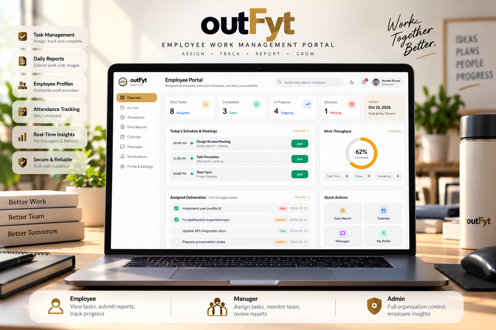

# EMPLOYEE-DASHBOARD

### outFyt — Employee Work Management Portal

**Assign. Track. Report. Grow.**

A centralized employee work management platform designed to organize tasks, monitor progress, and improve coordination between employees, managers, and administrators.

  

### Platform Overview & Core Capabilities

A modern, role-based workspace built for real-time accountability and operational clarity:

* **Task Management:** Individual, selected-group, and organization-wide task assignment with start dates, due dates, priority tiers, and independent employee progress tracking.
* **Daily Work Reports & Image Evidence:** Structured daily submissions with task linkage, hours logging, and multiple image attachment uploads stored securely in Supabase Storage.
* **Employee Profiles:** Complete organizational profile management with system IDs (`EMP01`–`EMP10`), job titles, departments, contact info, and avatar uploads.
* **Attendance Tracking:** Server-validated check-in/check-out timestamps, work hours calculation, remote work status, break tracking, and approval-based correction requests.
* **Manager Task Assignments & Report Approvals:** Comprehensive managerial oversight to assign deliverables, review employee progress, provide direct feedback, approve or request revisions on daily reports, and inspect team attendance.
* **Role-Based Portals:** Dedicated, secure workflows tailored specifically for Employees (`EMP1`–`EMP10`), Managers (`MAN01`), and Administrators (`ADM01`) with automatic routing upon login.
* **Administrative Oversight:** Full organization-wide directory access, deliverable auditing, report inspection, activity logs, system configuration, and broadcast announcements.

---

### Corporate Accounts & Portals

The application is configured with 12 dedicated enterprise identities:

| Account Type | Identifiers | Role & Access Scope |
| :--- | :--- | :--- |
| **Employees** | `EMP1` – `EMP10` | My Tasks, Daily Reports, Attendance, Profile & Settings, In-Portal Messages |
| **Manager** | `MAN01` | Team Task Assignment, Progress Monitoring, Report Reviews & Approvals, Attendance Oversight |
| **Admin** | `ADM01` | Organization-Wide Directory, Deliverable Audit, Security Logs, Portal Settings, Broadcasts |

---

### Technology Stack & Architecture

* **Frontend:** React 19, TypeScript, Tailwind CSS, Lucide Icons, Motion
* **Build Tool:** Vite
* **Backend & Server:** Node.js, Express (rate-limited `/api/login` endpoint)
* **Database & Authentication:** Supabase (PostgreSQL), Row-Level Security (RLS) policies, Supabase Storage